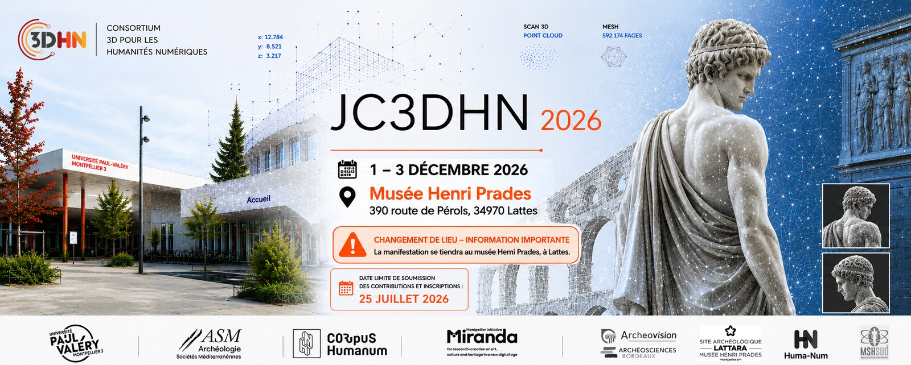

# Atelier DOPAMIn — du Nenuscanner au modèle 3D dans Meshroom

[](https://jc3dhn2026.sciencesconf.org/)

**Atelier 2 – Meshroom / Dopamine**, mardi 1er décembre 2026, 14 h – 17 h, musée Henri Prades (Lattes) —
[Journées du Consortium 3D pour les Humanités Numériques 2026](https://jc3dhn2026.sciencesconf.org/).

Vous allez **installer** Meshroom et ses plugins, puis **reconstruire** en 3D un objet photographié par le
Nenuscanner sous plusieurs éclairages.

> [!IMPORTANT]
> Faites les étapes 1 à 3 **avant l'atelier** : elles téléchargent 30 Go et durent 1 à 2 heures.

## Ce qu'il vous faut

| | |
| :-- | :-- |
| Système | Windows 10 ou 11, ou Linux (Ubuntu 22.04 ou plus récent) |
| Carte graphique | NVIDIA, pilote à jour (série RTX 30 ou plus récente pour LINO-UniPS) |
| Disque | 40 Go libres |

Windows n'a pas encore été testé : dites-nous ce qui coince.

## 1. Télécharger ce dépôt

1. Bouton vert **Code**, puis **Download ZIP**.
2. Extrayez le zip dans un dossier au nom court, sans espace ni accent :
   - Windows : `C:\dopamin`
   - Linux : `~/dopamin`

## 2. Installer Meshroom

| Windows | Linux |
| :-- | :-- |
| Double-cliquez sur **`installer.bat`**. | Ouvrez un terminal dans le dossier, puis tapez `./installer.sh` |
| Si Windows affiche « Windows a protégé votre ordinateur » : **Informations complémentaires**, puis **Exécuter quand même**. | |

Attendez le message **Meshroom est installé**. En cas de coupure, relancez.

<details>
<summary>Ou à la main, pour comprendre ce que fait le script</summary>

1. Ouvrez la page [Meshroom nightly](https://github.com/alicevision/Meshroom/releases/tag/nightly) et téléchargez
   `Meshroom-…-windows-full.zip` (Windows) ou `Meshroom-…-linux-full.tar.gz` (Linux).
2. Extrayez l'archive dans le dossier de ce dépôt, puis renommez le dossier obtenu en `Meshroom`.

Vous devez obtenir :

```text
dopamin/
├── Meshroom/
│   └── Meshroom.exe  (ou Meshroom sous Linux)
├── installer.bat, convertir.bat, meshroom.bat …
└── templates/
```

</details>

## 3. Installer les plugins dans Meshroom

Les méthodes de l'atelier sont des **plugins**, que Meshroom installe lui-même.

1. Lancez Meshroom : **`meshroom.bat`** (Windows) ou `./meshroom.sh` (Linux).
2. Cliquez sur le bouton **Manage Plugins**, en haut de la fenêtre.
3. Cherchez et installez, l'un après l'autre :

   | Plugin | Rôle |
   | :-- | :-- |
   | `mrSegmentation` | détourer l'objet (SAM 3) |
   | `mrLedGetter` | stéréophotométrie calibrée |
   | `mrLINOUniPS` | stéréophotométrie par apprentissage |
   | `mrRNbNeuS2` | reconstruction 3D à partir des normales |

4. Fermez Meshroom, puis lancez **`finaliser.bat`** (Windows) ou `./finaliser.sh` (Linux) : il vérifie les plugins et
   télécharge le moteur de RNb-NeuS2. Attendez le message **Tout est prêt**.

## 4. Reconstruire l'objet

**Préparer les photos.** Le Nenuscanner fournit une archive `.zip`. En attendant un export direct pour Meshroom,
glissez-la sur **`convertir.bat`** (Linux : `./convertir.sh chemin/vers/archive.zip`).
Un dossier `…_meshroom` apparaît à côté de l'archive.

<details>
<summary>Contenu du dossier</summary>

```text
archive_meshroom/
└── PS/
    ├── PS_01/                      un dossier par position de l'objet
    │   ├── led_01.nef … led_12.nef     une photo par LED
    │   └── ambient_all_leds.nef        toutes les LED allumées
    └── PS_02/ …
```

</details>

**Dans Meshroom :**

1. Lancez Meshroom : **`meshroom.bat`** (Windows) ou `./meshroom.sh` (Linux).
2. **File > Open Template**, puis choisissez un fichier du dossier `templates/` :
   - `nenuscanner_led_getter.mgt` : stéréophotométrie calibrée (LED-getter) ;
   - `nenuscanner_lino_unips.mgt` : stéréophotométrie par apprentissage (LINO-UniPS).

   Les deux détectent l'objet (SAM 3) et les marqueurs AprilTag 16h5 posés sur le plateau, et calculent les
   positions de l'appareil sur les photos « toutes LED ». Si vous avez aussi des photos classiques de l'objet (dossier `MV/` à côté de `PS/`), prenez
   `nenuscanner_mv_led_getter.mgt` ou `nenuscanner_mv_lino_unips.mgt`.
3. Glissez le dossier `…_meshroom` dans la galerie d'images, à gauche.
4. Cliquez sur le nœud **ImageSegmentationSam3** et écrivez dans **Prompt** ce qu'est l'objet, en anglais
   (`statue`, `vase`, `stone`…).
5. **File > Save As**, dans un nouveau dossier.
6. Cliquez sur **Start**.

Le modèle 3D texturé s'affiche dans la vue 3D à la fin du calcul.

## En cas de problème

| Problème | Solution |
| :-- | :-- |
| L'installation s'arrête | Relancez `installer.bat` ou `./installer.sh` |
| « Plugins manquants » | Installez-les dans Meshroom (étape 3), puis relancez `finaliser` |
| LINO-UniPS : `expected scalar type Half but found BFloat16` | Carte graphique trop ancienne : utilisez le template LED-getter |
| « Meshroom n'est pas encore installé » | Faites l'étape 2 |
| « Le dossier de sortie existe déjà » | Supprimez l'ancien dossier `…_meshroom`, ou renommez-le |

## Pour aller plus loin

- Bannière : affiche des [JC3DHN 2026](https://jc3dhn2026.sciencesconf.org/), © Consortium 3DHN
- Méthodes et jeux de données : [mvml-heritage-meshroom](https://github.com/bbrument/mvml-heritage-meshroom)
- [Meshroom](https://github.com/alicevision/Meshroom) et ses plugins : [MeshroomHub](https://github.com/meshroomHub)
