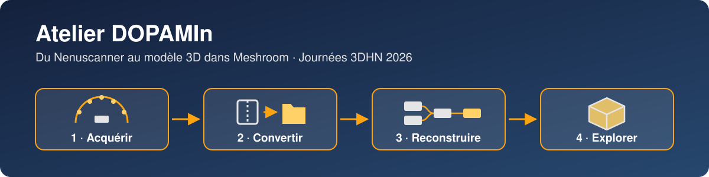

# Atelier DOPAMIn — du Nenuscanner au modèle 3D dans Meshroom



**Atelier 2 – Meshroom / Dopamine**, mardi 1er décembre 2026, 14 h – 17 h,
[Journées du Consortium 3D pour les Humanités Numériques 2026](https://jc3dhn2026.sciencesconf.org/).

Vous allez : **installer** Meshroom, **convertir** une acquisition du Nenuscanner, puis **reconstruire** l'objet en 3D
à partir de ses photos multi-éclairage.

> [!IMPORTANT]
> Faites les étapes 1 et 2 **avant l'atelier** : l'installation télécharge 30 Go et dure 1 à 2 heures.

## Ce qu'il vous faut

| | |
| :-- | :-- |
| Système | Windows 10 ou 11, ou Linux (Ubuntu 22.04 ou plus récent) |
| Carte graphique | NVIDIA, pilote à jour |
| Disque | 40 Go libres |

Windows n'a pas encore été testé : dites-nous ce qui coince.

## 1. Télécharger ce dépôt

1. Bouton vert **Code**, puis **Download ZIP**.
2. Extrayez le zip dans un dossier au nom court, sans espace ni accent :
   - Windows : `C:\dopamin`
   - Linux : `~/dopamin`

## 2. Installer Meshroom et ses plugins

| Windows | Linux |
| :-- | :-- |
| Double-cliquez sur **`installer.bat`**. | Ouvrez un terminal dans le dossier, puis tapez `./installer.sh` |
| Si Windows affiche « Windows a protégé votre ordinateur » : **Informations complémentaires**, puis **Exécuter quand même**. | |

Laissez la fenêtre ouverte jusqu'au message **Installation terminée**. En cas de coupure, relancez : l'installation
reprend où elle s'est arrêtée.

## 3. Convertir l'acquisition du Nenuscanner

Le Nenuscanner fournit une archive `.zip` (photos et fichier `descriptor.yaml`).

| Windows | Linux |
| :-- | :-- |
| Glissez l'archive sur **`convertir.bat`**. | `./convertir.sh chemin/vers/archive.zip` |

Répondez **1** (rapide) à la question sur la résolution. Un dossier `…_meshroom_rapide` apparaît à côté de l'archive :

```text
archive_meshroom_rapide/
└── PS/
    ├── PS_01/                      un dossier par position de l'objet
    │   ├── led_01.jpg … led_12.jpg     une photo par LED
    │   └── ambient_all_leds.jpg        toutes les LED allumées
    └── PS_02/ …
```

## 4. Reconstruire dans Meshroom

1. Lancez Meshroom : **`meshroom.bat`** (Windows) ou `./meshroom.sh` (Linux).
2. **File > Open Template**, puis choisissez un fichier du dossier `templates/` :
   - `nenuscanner_led_getter.mgt` : stéréophotométrie calibrée (LED-getter) ;
   - `nenuscanner_lino_unips.mgt` : stéréophotométrie par apprentissage (LINO-UniPS).
3. Glissez le dossier `…_meshroom_rapide` dans la galerie d'images, à gauche.
4. Cliquez sur le nœud **ImageSegmentationSam3** et écrivez dans **Prompt** ce qu'est l'objet, en anglais
   (`statue`, `vase`, `stone`…).
5. **File > Save As**, dans un nouveau dossier.
6. Cliquez sur **Start**.

Le modèle 3D texturé s'affiche dans la vue 3D à la fin du calcul.

## En cas de problème

| Problème | Solution |
| :-- | :-- |
| L'installation s'arrête | Relancez `installer.bat` ou `./installer.sh` |
| « Meshroom n'est pas encore installé » | Faites l'étape 2 |
| « Le dossier de sortie existe déjà » | Supprimez l'ancien dossier `…_meshroom_rapide`, ou renommez-le |

## Pour aller plus loin

- Méthodes et jeux de données : [mvml-heritage-meshroom](https://github.com/bbrument/mvml-heritage-meshroom)
- [Meshroom](https://github.com/alicevision/Meshroom) et ses plugins : [MeshroomHub](https://github.com/meshroomHub)
