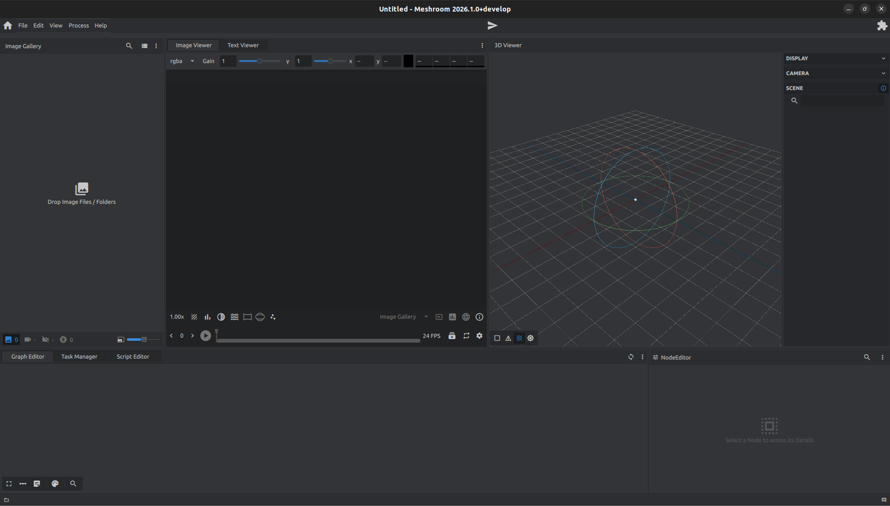
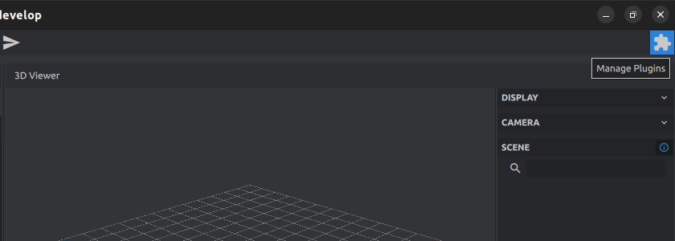
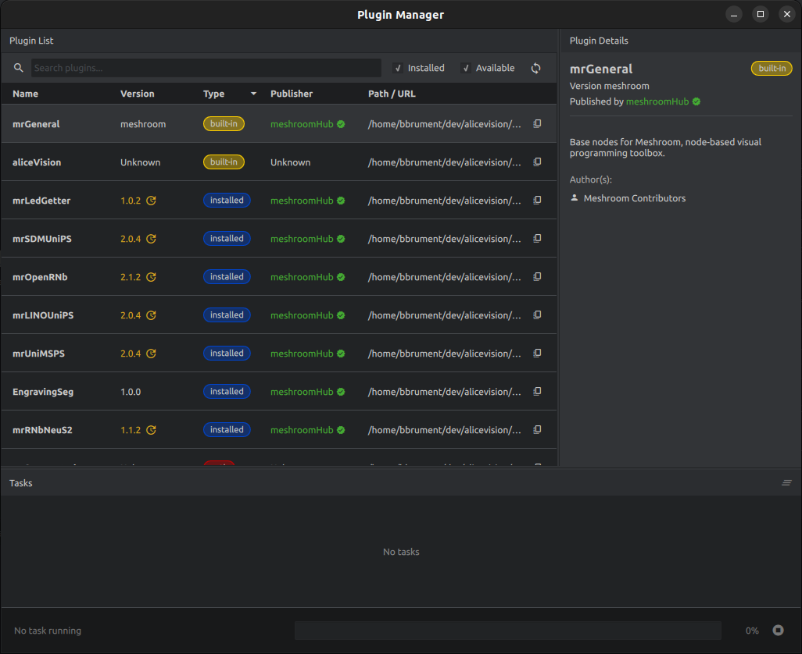
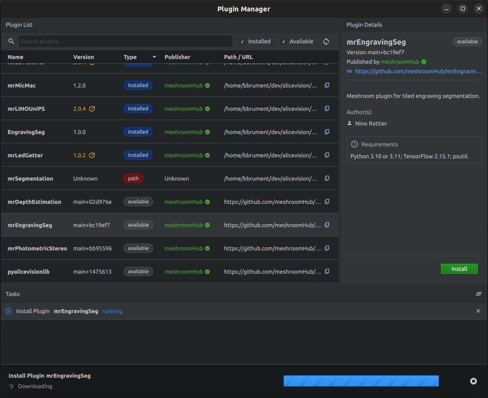

# Installer les plugins dans Meshroom

Les méthodes de l'atelier sont des **plugins**. Meshroom les télécharge et les installe lui-même, depuis sa fenêtre
**Plugin Manager**. Les captures viennent d'un poste où des plugins sont déjà installés : votre liste sera différente.

## 1. Ouvrir le Plugin Manager

Lancez Meshroom : **`meshroom.bat`** (Windows) ou `./meshroom.sh` (Linux).

Cliquez sur le bouton **Manage Plugins** (pièce de puzzle), en haut à droite.

## 2. Choisir un plugin

La liste montre les plugins déjà présents (`installed`) et ceux que l'on peut ajouter (`available`). Tapez un nom dans
**Search plugins** pour le retrouver, puis cliquez sur sa ligne : sa description s'affiche à droite.

## 3. Installer

Cliquez sur **Install**, en bas à droite.

L'installation apparaît dans **Tasks**, avec une barre de progression en bas. Attendez la mention `done` avant de
passer au plugin suivant.

Installez ainsi les quatre plugins de l'atelier :

| Plugin | Rôle |
| :-- | :-- |
| `mrSegmentation` | détourer l'objet (SAM 3) |
| `mrLedGetter` | stéréophotométrie calibrée |
| `mrLINOUniPS` | stéréophotométrie par apprentissage |
| `mrRNbNeuS2` | reconstruction 3D à partir des normales |

`mrSegmentation` télécharge environ 16 Go de modèles : comptez une à deux heures selon la connexion.

## 4. Redémarrer Meshroom

Un bandeau bleu demande de redémarrer : cliquez sur **Restart Now**.

Plus tard, le bouton **Update** met un plugin à jour, et **Remove** le supprime.

Revenez ensuite au [guide principal](../README.md#3-installer-les-plugins-dans-meshroom) pour lancer `finaliser`.
